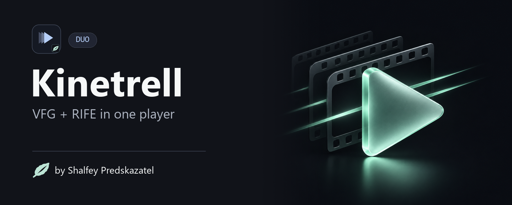

# Kinetrell

[Русский](README.ru.md) · [Latest release](https://github.com/Yamidashka/kinetrell/releases/latest) · [Changelog](RELEASE-NOTES.md)

Kinetrell (formerly RTX Video Player) is a portable mpv-based player for Windows 10 and 11 x64. It adds frame interpolation, NVIDIA RTX Video Super Resolution, RTX Video HDR and a Russian/English playback bar.

| Edition | Frame generation | Windows x64 |
| --- | --- | --- |
| **VFG** | NVIDIA VFG · Maxine VFX 1.3.0 + VFG | [Download ZIP](https://github.com/Yamidashka/kinetrell/releases/download/v1.3.0/Kinetrell-VFG-v1.3.0-Windows-x64.zip) |
| **RIFE** | RIFE 4.4 / 4.6 / 4.17 Lite · DirectML | [Download ZIP](https://github.com/Yamidashka/kinetrell/releases/download/v1.3.0/Kinetrell-RIFE-v1.3.0-Windows-x64.zip) |
| **Duo** | VFG / RIFE / Off · Maxine VFX 1.3.0 + DirectML | [Download ZIP](https://github.com/Yamidashka/kinetrell/releases/download/v1.3.0/Kinetrell-Duo-v1.3.0-Windows-x64.zip) |

Extract the entire ZIP into a writable folder and run the launcher listed below. Open a file through the launcher or drag it onto the EXE.

- **VFG** — `RTX Video Player.exe`. Maxine VFX and the VFG component are included. A compatible NVIDIA RTX GPU and driver are required.
- **RIFE** — `RTX Video Player RIFE.exe`. The DirectML runtime and three models are included.
- **Duo** — `RTX Video Player Combined.exe`. Choose VFG, RIFE or Off from the first button. Each generator remembers its quality and multiplier.

Pick **Auto** to select an integer multiplier for the source and display refresh rate, or select **2×–6×** manually. For RTX Video HDR, enable HDR in Windows. High multipliers depend on the source, GPU and other enabled filters.

[Build instructions](BUILD.md) · [SHA-256 checksums](SHA256SUMS.txt) · [Optional TensorRT](TENSORRT.md) · [Third-party terms](THIRD-PARTY.md)
