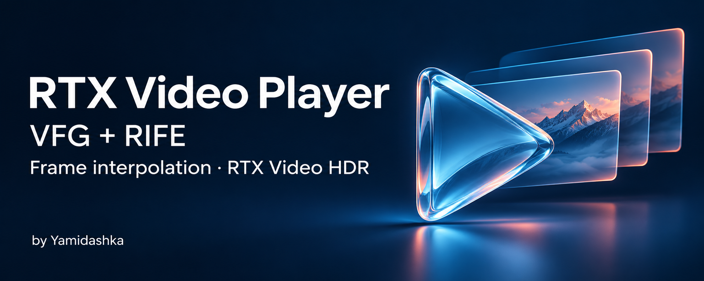

# RTX Video Player

[English](README.md) · [Скачать v1.1.0](https://github.com/Yamidashka/rtx-video-player/releases/tag/v1.1.0)

Портативный проигрыватель для Windows на базе mpv с генерацией кадров, RTX Video Super Resolution и RTX Video HDR.

- **VFG** использует установленный NVIDIA Maxine Video Effects SDK с компонентом Video Frame Generation.
- **RIFE** использует DirectML из архива. Включены модели 4.4, 4.6 и 4.17 Lite. Для модели 4.17 Lite можно подключить TensorRT.

Скачайте ZIP в разделе [**Releases**](https://github.com/Yamidashka/rtx-video-player/releases/latest), распакуйте его целиком и запустите **RTX Video Player.exe** или **RTX Video Player RIFE.exe**. Кнопка **VFG** или **RIFE** открывает меню **Выкл., 2×, 3×, 4×, 5× и 6×**. Кнопка **RU / EN** меняет язык панели и меню генерации. Главное меню **☰** меняет язык при следующем запуске.

Настройки сохраняются в папке проигрывателя. Новый файл, открытый через тот же EXE, заменяет текущее видео. Для RTX Video HDR включите HDR в Windows. Плавность зависит от разрешения, исходной частоты кадров, модели и видеокарты.

[Сборка](BUILD.md) · [Подключение TensorRT](TENSORRT.md) · [Сторонние компоненты](THIRD-PARTY.md)

## Скачать для Windows x64

| Редакция | Готовая программа | Требования к генерации кадров |
| --- | --- | --- |
| VFG | [Скачать ZIP VFG](https://github.com/Yamidashka/rtx-video-player/releases/download/v1.1.0/RTX-Video-Player-VFG-v1.1.0.zip) | Отдельно установленный NVIDIA Maxine Video Effects SDK с компонентом VFG. |
| RIFE | [Скачать ZIP RIFE](https://github.com/Yamidashka/rtx-video-player/releases/download/v1.1.0/RTX-Video-Player-RIFE-v1.1.0.zip) | DirectML и модели уже включены в архив. |

Распакуйте ZIP в папку с правом записи и запускайте EXE. Сохраняйте все файлы распакованной папки вместе. Архивы **Source code** на GitHub предназначены для работы с исходниками; для запуска скачивайте ZIP нужной редакции из таблицы.

Для RTX Video Super Resolution и RTX Video HDR нужна совместимая видеокарта NVIDIA RTX и драйвер. Доступность множителя в меню не гарантирует работу в реальном времени на любом разрешении.

Контрольные суммы: [SHA256SUMS.txt](https://github.com/Yamidashka/rtx-video-player/releases/download/v1.1.0/SHA256SUMS.txt). Проверка в PowerShell:

```powershell
Get-FileHash .\RTX-Video-Player-RIFE-v1.1.0.zip -Algorithm SHA256
```

Обе редакции используют общие исходники проигрывателя и лаунчера из этого репозитория. Исходники изменённого mpv и сведения о лицензиях включены в ZIP. Условия лицензирования проекта: [LICENSE.md](LICENSE.md).

Это независимый проект на базе mpv, а не официальный продукт NVIDIA.
