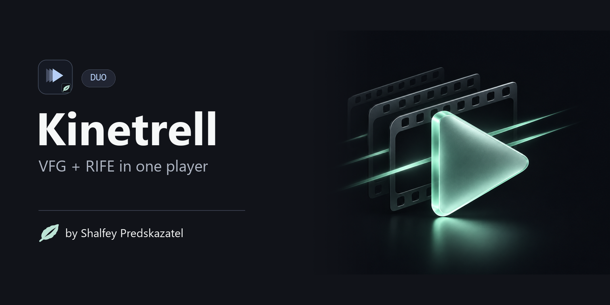

# Kinetrell v1.3.0 — VFG, RIFE & Duo

## English

- Added **Duo**, which switches between NVIDIA VFG, RIFE, and Off and remembers separate settings for each generator.
- Added automatic frame-generation multipliers and compact menus for quality, the RIFE model, and RTX SR resolution.
- RTX SR screen mode follows the display resolution. On seekable media, changing filters clears queued frames and resumes at the current position.
- VFG and Duo include Maxine VFX 1.3.0. RIFE and Duo include the DirectML runtime and RIFE 4.4, 4.6, and 4.17 Lite models.

## Русский

- Добавлена редакция **Duo**: переключение между NVIDIA VFG, RIFE и выключенной генерацией кадров. Для каждой технологии отдельно сохраняются настройки.
- Добавлен автоматический выбор множителя генерации кадров и компактные меню качества, модели RIFE и разрешения RTX SR.
- Режим экрана RTX SR подстраивается под разрешение дисплея. При смене фильтров на перематываемом видео очередь кадров очищается, воспроизведение продолжается с текущей позиции.
- В VFG и Duo включён Maxine VFX 1.3.0. В RIFE и Duo включены DirectML Runtime и модели RIFE 4.4, 4.6 и 4.17 Lite.

## Downloads / Скачать

Windows 10 / 11 x64. Extract the complete ZIP and launch the EXE for the edition you want. / Windows 10 / 11 x64. Распакуйте ZIP целиком и запустите EXE нужной редакции.

- **VFG** · `RTX Video Player.exe` · Maxine VFX 1.3.0 + VFG · [Download / Скачать](https://github.com/Shalfey-Predskazatel/Kinetrell/releases/download/v1.3.0/Kinetrell-VFG-v1.3.0-Windows-x64.zip)
- **RIFE** · `RTX Video Player RIFE.exe` · DirectML · [Download / Скачать](https://github.com/Shalfey-Predskazatel/Kinetrell/releases/download/v1.3.0/Kinetrell-RIFE-v1.3.0-Windows-x64.zip)
- **Duo** · `RTX Video Player Combined.exe` · Maxine VFX 1.3.0 + DirectML · [Download / Скачать](https://github.com/Shalfey-Predskazatel/Kinetrell/releases/download/v1.3.0/Kinetrell-Duo-v1.3.0-Windows-x64.zip)

[SHA-256 checksums](https://github.com/Shalfey-Predskazatel/Kinetrell/releases/download/v1.3.0/SHA256SUMS.txt) · [Русская инструкция / Russian guide](https://github.com/Shalfey-Predskazatel/Kinetrell/blob/main/README.ru.md) · [Third-party terms](https://github.com/Shalfey-Predskazatel/Kinetrell/blob/main/THIRD-PARTY.md)

---

# RTX Video Player v1.2.1

- Tightened spacing between playback buttons in all editions.
- RTX SR automatic scaling stays consistent when the window is resized. The SR button distinguishes off from 1:1 output.
- On seekable media, changing the filter chain clears queued frames and resumes from the current position. The new filter may need a moment to initialize.

# RTX Video Player v1.2.0

- Added the **Combined** edition. Switch between VFG, RIFE and Off from the playback bar. Each generator remembers its multiplier and quality independently.
- RTX Video Super Resolution and RTX Video HDR controls are shared in the Combined edition.
- The separate **VFG** and **RIFE** editions remain available. All editions include the **RU / EN** language switch and multipliers from **2× through 6×**.

Extract the complete ZIP and run the EXE. VFG requires the NVIDIA Maxine Video Effects SDK with Video Frame Generation. RIFE works through DirectML, with optional TensorRT for 4.17 Lite.
